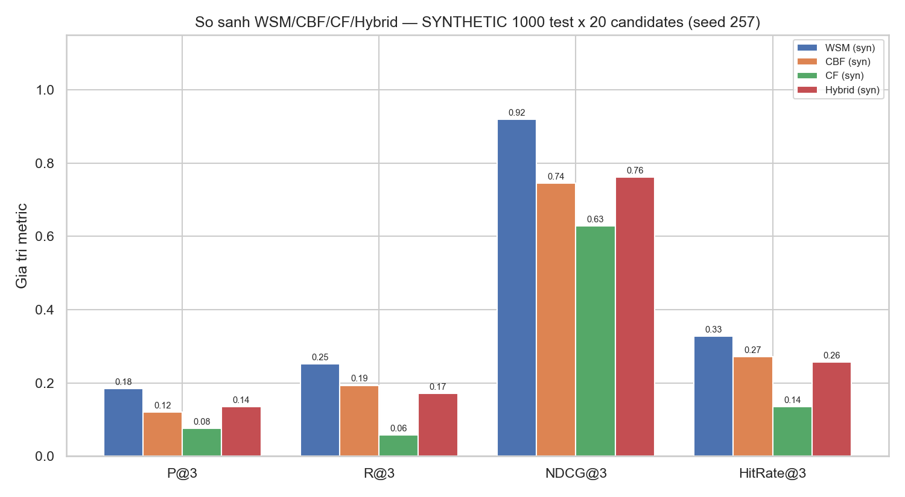
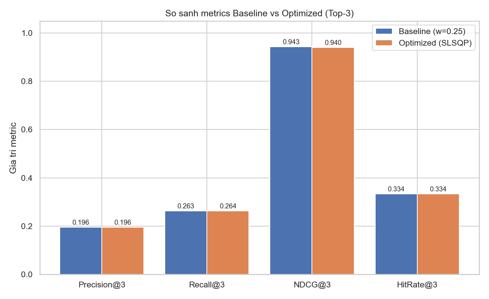
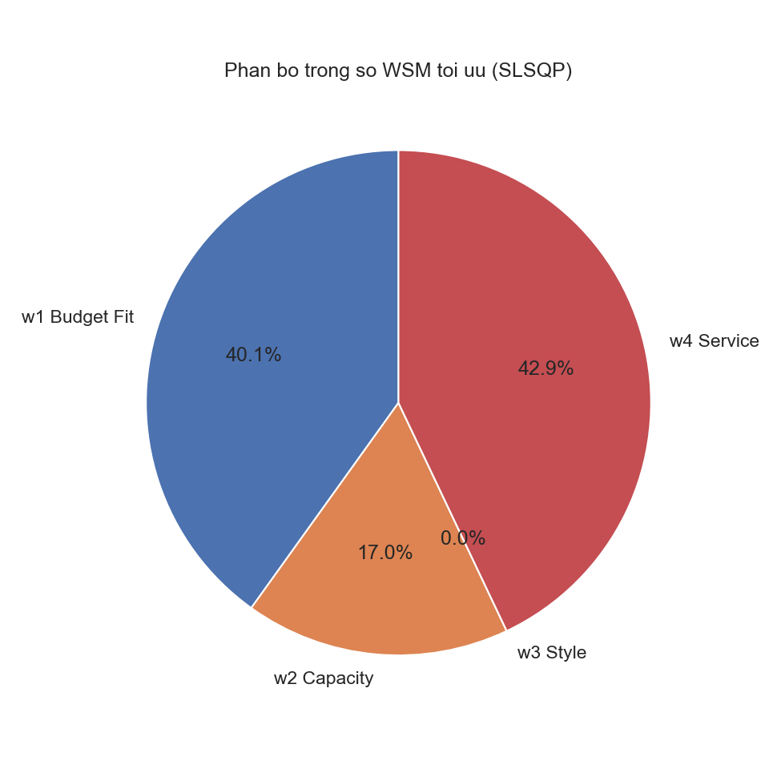
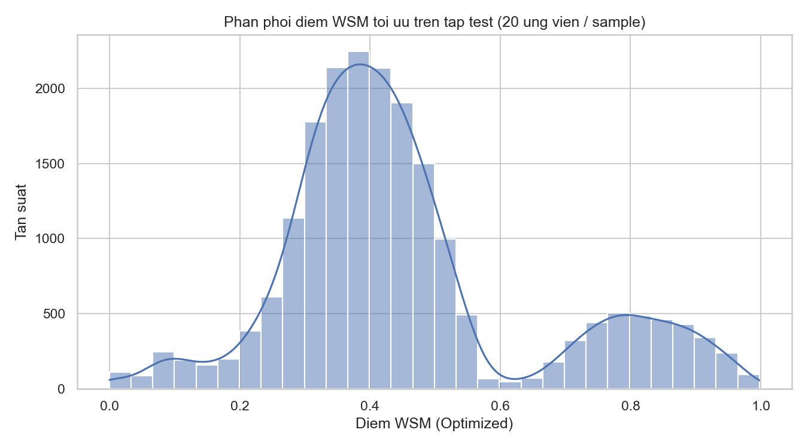

# Hệ thống gợi ý Riverside Palace — Đối chiếu đề cương CNTT-KLCN257 & mã nguồn

## 1. Thuật toán & vị trí mã nguồn

Toàn bộ thuật toán khuyến nghị nằm trong AI_Service/app/core (Python). Mô hình chính là Hybrid (kết hợp CF + CBF + MCDM/WSM).

| Thuật toán | File | Hàm (dòng) | Vai trò |
|---|---|---|---|
| CBF — Content-Based Filtering | AI_Service/app/core/cbf_engine.py | build_index() :73 · cbf_score() :95 | Vector hóa TF-IDF hồ sơ hall/menu/decor, so khớp cosine với sở thích |
| CF — Collaborative Filtering | AI_Service/app/core/cf_engine.py | fit() :79 · predict_rating() :108 · cf_score() :123 | Ma trận user–item (SampleId × Hall_Menu_Decor), phân rã TruncatedSVD n=20 |
| MCDM / WSM | AI_Service/app/core/wsm_engine.py | score_candidate() :72 · rank_top3() :142 | Tổng có trọng số w1..w4: ngân sách, sức chứa, phong cách, dịch vụ |
| Hybrid — mô hình chính | AI_Service/app/core/hybrid_engine.py | load_hybrid_weights() :24 · fuse() :55 · rank_candidates() :62 | s_final = α·s_cf + β·s_cbf + γ·S_wsm (α, β, γ học từ dữ liệu) |
| LLM + RAG — trợ lý AI | AI_Service/app/core/rag_engine.py | chat() ~:586 · extract_entities() :794 | Trợ lý tiếng Việt (Gemini gemini-3.5-flash-lite) + trích thực thể cho khảo sát |

## 2. Đối chiếu yêu cầu đề cương

| Yêu cầu đề cương | Hiện trạng | Trạng thái |
|---|---|---|
| Môi trường LLM và RAG | rag_engine.py (retrieval + Gemini gemini-3.5-flash-lite); kho tri thức riverside_knowledge.md | Đạt ✅ |
| Cài đặt bằng Python + FastAPI, tích hợp ASP.NET Core | AI_Service (FastAPI :8000); Backend/Frontend gọi qua API nội bộ | Đạt ✅ |
| Content-Based Filtering (CBF) | cbf_engine.py — TF-IDF + cosine | Đạt ✅ |
| Collaborative Filtering (CF) trên dữ liệu tiệc cưới trước đó | cf_engine.py (SVD) đã hoạt động; hiện huấn luyện trên dữ liệu SYNTHETIC (wedding_dataset_5k.csv) | Một phần ⚠️ — cần dữ liệu thật |
| Hybrid | hybrid_engine.py; α/β/γ học từ dữ liệu (hybrid_weights.json) | Đạt ✅ |
| MCDM / WSM | wsm_engine.py; w1..w4 tối ưu bằng SLSQP (trained_weights.json) | Đạt ✅ |
| Phân tích đầu vào: ngân sách, số bàn, thời gian, phong cách | wsm_engine.score_candidate + rag_engine.extract_entities (ngày/ca/khách) | Đạt ✅ |
| Gợi ý Top-3 sảnh / menu / decor | rank_top3() và rank_candidates(); hiển thị tại /Recommendation/Index | Đạt ✅ |
| Docker & Docker Compose | docker-compose.yml (service ai) + Dockerfile từng tầng | Đạt ✅ |
| Jupyter Notebook thực nghiệm | notebooks/demo_recommender.ipynb + các script thực nghiệm + biểu đồ output_plots | Đạt ✅ |
| Tài liệu tham khảo (Aggarwal, Koren, Lewis, Ricci, scikit-learn) | Áp dụng trong cbf_engine / cf_engine / rag_engine / notebook demo | Đạt ✅ |
| Dữ liệu các tiệc cưới thành công thật | wedding_reviews_real.csv hiện chỉ là mẫu mô phỏng (SAMPLE_NOTE); cần export từ DB thật | Một phần ⚠️ |

## 3. Mô hình chính & so sánh mô hình

Mô hình chính: Hybrid — s_final = α·s_cf + β·s_cbf + γ·S_wsm với α=0.65, β=0.05, γ=0.30 (học từ dữ liệu bằng SLSQP + grid-search, lưu tại app/core/hybrid_weights.json; MSE train=0.0374, MSE val=0.0188).

Ablation — bỏ từng thành phần (MSE trên tập validation): α=0 (bỏ CF): 0.1331; β=0 (bỏ CBF): 0.0179; γ=0 (bỏ WSM): 0.0323.

Trọng số WSM đang triển khai (wsm_engine dùng để xếp hạng thực tế): w1=0.3004, w2=0.3198, w3=0.1799, w4=0.1999. Bảng so sánh 4 mô hình bên dưới đánh giá theo bộ trọng số này.

Thực nghiệm huấn luyện lại trọng số WSM bằng SLSQP (min MSE giữa điểm S và Satisfaction/5.0; kết quả chỉ để đối chiếu, KHÔNG ghi đè trọng số đang triển khai) trên 4000 mẫu huấn luyện / 1000 mẫu kiểm thử. Baseline w=[0.25, 0.25, 0.25, 0.25] so với tối ưu w=[0.4010, 0.1695, 0.0000, 0.4295]. MSE test: baseline=0.0816 → tối ưu=0.0207.

So sánh 4 mô hình (dùng trọng số WSM đang triển khai) trên cùng tập test (Top-3, relevant = grade ≥ 2, 1000 mẫu × 20 ứng viên, seed 257):

| Mô hình | P@3 | R@3 | NDCG@3 | HitRate@3 |
|---|---|---|---|---|
| WSM | 0.1850 | 0.2524 | 0.9192 | 0.3280 |
| CBF | 0.1197 | 0.1934 | 0.7449 | 0.2710 |
| CF | 0.0753 | 0.0583 | 0.6286 | 0.1350 |
| Hybrid | 0.1350 | 0.1706 | 0.7620 | 0.2570 |

Baseline vs Optimized (WSM) — cùng tập test Top-3:

| Cấu hình WSM | P@3 | R@3 | NDCG@3 | HitRate@3 | MSE train | MSE test |
|---|---|---|---|---|---|---|
| Baseline (w = 0.25 đều) | 0.1957 | 0.2631 | 0.9433 | 0.3340 | 0.0792 | 0.0816 |
| Optimized (SLSQP) | 0.1960 | 0.2637 | 0.9402 | 0.3340 | 0.0204 | 0.0207 |

## 4. Hình ảnh minh chứng

Các biểu đồ được sinh tự động khi chạy thực nghiệm, lưu tại AI_Service/notebooks/output_plots.

| Ảnh | Script tạo | Nội dung |
|---|---|---|
| hybrid_comparison.png | notebooks/evaluate_hybrid.py:187 | So sánh WSM/CBF/CF/Hybrid theo P@3, R@3, NDCG@3, HitRate@3 |
| metrics_comparison.png | notebooks/train_and_evaluate.py:220 | Baseline vs Optimized (4 chỉ số Top-3) |
| weight_distribution.png | notebooks/train_and_evaluate.py:228 | Phân bố trọng số WSM tối ưu (w1..w4) |
| score_distribution.png | notebooks/train_and_evaluate.py:237 | Phân phối điểm WSM tối ưu trên tập test |

## 5. Ghi chú & hạn chế

Nguồn dữ liệu: SYNTHETIC wedding_dataset_5k.csv — MÔ PHỎNG, không phải dữ liệu thật. Kết quả mang tính mô phỏng; khi có dữ liệu tiệc cưới thật, chạy app/core/export_reviews.py rồi huấn luyện lại CF/Hybrid/WSM.

Toàn bộ chỉ số số học được lưu tự động tại notebooks/output_plots/metrics_summary.json (sinh bởi notebooks/export_metrics.py).

Hệ thống giữ bộ trọng số WSM đang triển khai: w1=0.3004, w2=0.3198, w3=0.1799, w4=0.1999 để tiêu chí phong cách (w3) vẫn đóng góp vào điểm. Khi huấn luyện lại trên dữ liệu mô phỏng, SLSQP đẩy w3→0.0000 (không triển khai) — cần huấn luyện lại khi có dữ liệu thật.

Hạn chế: script huấn luyện dùng điểm r1 đơn giản, chưa đồng bộ với chia bậc vượt ngân sách trong wsm_engine.score_candidate — cần đồng bộ khi huấn luyện với dữ liệu thật.
